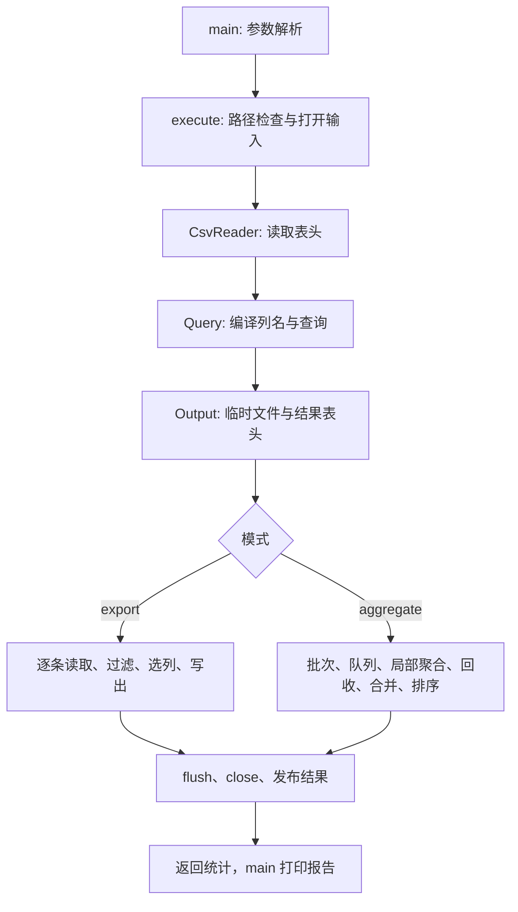
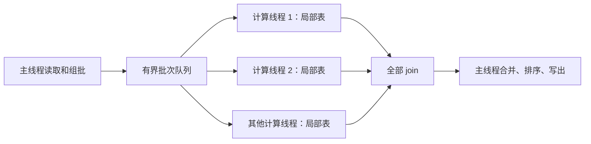

# FlashCSV 代码讲解

先完成[从零学习指南](learning-guide.md)中的命令练习，再读本文。这里按当前源码讲解实现，核对日期为 2026-10-12。
功能与验收规则仍以[设计](design.md)为准；本文解释这些规则怎样落到代码中。

阅读时区分三类内容：源码片段是实际代码；标注“示意”的流程或数据是为了说明原理；性能与验证结论必须有实测依据。

## 1. 先找到入口和模块

### 1.1 目录分别放什么

| 位置 | 内容 | 建议读法 |
|---|---|---|
| [CMakeLists.txt](../CMakeLists.txt) | 构建目标和测试注册 | 先看程序与库如何连接 |
| [include/flash_csv/](../include/flash_csv/) | 类型与接口声明 | 先弄清每个类对外提供什么操作 |
| [src/](../src/) | 核心实现 | 跟随下面的函数调用顺序阅读 |
| [tests/](../tests/) | 核心、资源生命周期和命令行测试 | 对照边界条件阅读 |
| [tools/](../tools/) | 数据生成与基准脚本 | 最后理解测量方法 |
| `build/`、`data/`、`reports/` | 构建产物、生成数据、报告 | 用于运行与验证，不是核心源码 |

头文件中的“声明”告诉调用者一个类型或函数怎样使用；源文件中的“定义”实现它的行为。
例如 [csv.hpp](../include/flash_csv/csv.hpp) 声明 `CsvReader::next`，而 [csv.cpp](../src/csv.cpp) 实现记录解析。
部分简单成员函数直接定义在头文件中，例如 `header()`。

[CMakeLists.txt](../CMakeLists.txt) 建立 `flash_csv_core` 库，包含 csv、query、aggregate、pipeline、engine 五个实现文件。
`flash_csv` 可执行目标由 `main.cpp` 提供入口，再链接这个库。测试也链接同一核心库。
`Threads::Threads` 表达平台线程支持的构建需求；测试配置还寻找 Python 解释器，用于命令行验收。

### 1.2 `main` 的责任很集中

入口位于 [main.cpp](../src/main.cpp)。正常调用依次执行：

```text
parse_arguments(argc, argv) → Config
execute(config)             → Statistics
report(stats)              → stderr 中的统计文字
```

`argc` 是命令行参数数量；`argv` 是参数字符串数组。`parse_arguments` 把这些文字组织成 `Config`。
请求帮助时，`main` 打印 `usage()` 并返回，不执行数据处理。

`main` 的 `try/catch` 是程序最外层的错误出口：

| 捕获对象 | 处理方式 |
|---|---|
| `flash_csv::Error` | 打印 `what()`，返回对象保存的退出码 |
| 其他 `std::exception` | 打印异常描述，返回 1 |
| 其他异常 | 打印通用错误，返回 1 |

`Error` 继承 `std::runtime_error`，另存一个退出码。错误消息的组装位于 [query.cpp](../src/query.cpp)，可包含错误种类、原始行号、列名与原因。
配置错误和运行错误可以经过相同的异常传播路径，同时保留不同退出码。

### 1.3 `execute` 组织整个执行过程

实现位于 [engine.cpp](../src/engine.cpp)。按当前代码顺序：

1. 检查执行容量参数，启动 `steady_clock` 计时。
2. `validate_paths` 检查输入类型、输出是否存在和输入输出是否为同一文件。
3. 打开二进制输入流，构造 `CsvReader`；其构造函数立即读取和验证表头。
4. 根据表头构造 `const Query`，把列名解析为列下标。
5. 构造 `Output`，创建临时文件，并向临时流写入输出表头。
6. 按模式进行导出或并行聚合。
7. 收集输入字节数，调用 `Output::publish()` 发布结果。
8. 计算耗时并返回 `Statistics`。

下面是执行结构示意；聚合分支内部还包含线程管理：



配置检查不是全都发生在同一个函数里。参数形态和模式冲突由 `parse_arguments` 检查；
列名是否存在等需要输入表头的信息，在 `Query` 构造时检查；输入格式错误由 `CsvReader` 检查。
例如，坏表头属于输入数据问题，而不存在的查询列属于查询配置问题。

## 2. 数据类型与所有权

先读 [types.hpp](../include/flash_csv/types.hpp)。这些类型连接各模块。

几个会反复出现的 C++ 写法，可以先按下面的含义理解，再结合具体函数阅读：

| 写法 | 在本文中的含义 |
|---|---|
| `std::` | 使用 C++ 标准库中的名称 |
| `vector<T>` | 可增长的连续元素容器 |
| `const T&` | 通过引用读取已有对象；不能通过此引用修改对象 |
| `unique_ptr<T>` | 独占管理一个动态对象，生命周期结束时自动释放 |
| `optional<T>` | 保存一个值，或明确表示没有值 |
| `try/catch`、`throw` | 传播和捕获异常 |
| `[&, i] { ... }` | Lambda：默认按引用捕获所用外部变量，单独按值保存 `i` |

| 类型 | 保存什么 | 主要用途 |
|---|---|---|
| `Config` | 模式、文件路径、查询参数、线程数、容量 | 保存用户请求 |
| `FilterSpec` / `AggSpec` | 使用列名表达的过滤和聚合要求 | 参数解析的结果 |
| `Row` | 原始行号与 `vector<string>` 字段 | 一条已解析记录 |
| `Batch` | `vector<Row>` 与字段内容字节数 | 队列中的工作单位 |
| `Limits` | 记录、批次、队列、分组上限 | 容量配置 |
| `Query` | 列下标、已编译过滤项、聚合项、输出表头 | 执行查询 |
| `GroupState` | 某组的计数和聚合数值槽位 | 保存累计结果 |
| `Statistics` | 行数、字节数、线程数、时间 | 生成成功报告 |

`enum class` 为模式、比较操作和聚合函数定义有限的取值集合，避免在处理每条记录时反复用文字判断操作类型。

### 2.1 字符串内容归谁保存

`Row::fields` 中的每个 `std::string` 自己持有字段内容，记录不是指向读取缓冲区的视图。
因此，`CsvReader` 下一次覆盖自己的 64 KiB 缓冲区后，已经解析出来的 `Row` 仍然有效。

`Batch` 持有这些 `Row`。主线程使用：

```cpp
if (!queue.push(std::move(batch))) break;
```

`std::move` 本身只是允许把对象当作可移动的值使用，实际移动由相应构造或赋值操作完成。
在这里，`Batch` 按值传给 `push`，其中的标准容器可转移其存储，再移动进队列，随后移动给消费者。
移动后的源对象仍可销毁和重新赋值；不要依赖它仍保存原来的记录。
这减少了批次内容的深拷贝，但不能推导出“整个入队操作一定零分配”，因为队列容器自身也可能分配存储。

分组表的键类型是 `std::string`。插入新组时，哈希表保存自己的键内容，因而批次被释放后，分组名不会悬空。
`Query::project` 则建立新的输出字段向量，并复制所选字段；它没有返回原记录的引用集合。

### 2.2 哪些对象被引用，寿命如何保证

`CsvReader` 引用输入流；`BatchReader` 引用 `CsvReader` 和 `Limits`；`Aggregator` 引用 `Query`。
这些引用不延长被引用对象的寿命。正确性依赖 `execute` 和聚合函数的作用域安排：

- 输入流先于 `CsvReader` 建立，并在读取完成后才销毁。
- `Query` 在工作线程启动前构造，线程全部 `join` 后才离开它的有效作用域。
- 每个工作线程只修改对应的局部聚合器，所有线程读同一个只读查询。

`Query::group_column()` 返回 `optional<size_t>`：没有值表示整体统计；有值表示分组列下标。
下标 0 是合法列位置，所以不能用“下标为 0”表示没有分组。

这里的只读查询能被共享，是因为当前查询方法不修改共享成员；`const` 这个写法本身不是任意类型线程安全的证明。

## 3. CSV 解析：缓冲读取加状态机

源码：[csv.hpp](../include/flash_csv/csv.hpp)、[csv.cpp](../src/csv.cpp)。

### 3.1 读取缓冲区与记录上限是两个概念

`CsvReader` 有固定的 `array<char, 64 * 1024>` 读取缓冲区。`peek()` 查看下一个字节而不消费，`take()` 消费一个字节并增加输入字节计数。
缓冲区用完后，`peek()` 再调用 `istream::read` 补充数据。

这个缓冲区大小并不随 `--max-record-bytes` 改变。一条记录可以跨越多个缓冲区，记录是否超限由解析时的 `raw_bytes` 单独判断。
读取缓冲区也没有保存整个输入文件。

补充缓冲区时，`gcount()` 给出实际读到的字节数；到 EOF 的短读取可能仍带回最后一段有效数据。
程序先处理这段数据，再在缓冲区耗尽时返回 EOF。
`bad()` 或“失败但并非 EOF”的流状态产生读取错误，避免把 I/O 故障当成正常文件结束。

字节转换为 `unsigned char` 后放进 `int` 返回；EOF 用 `-1` 表示。这样字节 `0xff` 不会因为有符号 `char` 的解释而混同于 EOF。

### 3.2 四个解析状态

`record()` 内部有四种状态：

| 状态 | 含义 |
|---|---|
| `Start` | 位于一个字段开头，尚未读入字段内容 |
| `Plain` | 正在读未加引号的字段 |
| `Quoted` | 正在读双引号包围的字段内容 |
| `Closed` | 刚读到引号，可能是字段结束，也可能是转义引号的一半 |

下面列出非行结束、非 EOF 字节的主要转移。这里的“提交字段”是把当前字符串移动到 `row.fields`。

| 当前状态 | 普通字符 | 逗号 | 双引号 |
|---|---|---|---|
| `Start` | 追加字符，进入 `Plain` | 提交空字段，回到 `Start` | 进入 `Quoted` |
| `Plain` | 追加字符 | 提交字段，回到 `Start` | 格式错误 |
| `Quoted` | 追加字符 | 作为字段内容追加 | 进入 `Closed` |
| `Closed` | 格式错误 | 提交字段，回到 `Start` | 追加一个双引号，回到 `Quoted` |

以 `"a""b"` 为例：第一个引号打开字段，`a` 被追加，后续两个引号先进入 `Closed` 再追加一个引号，
`b` 被追加，最后一个引号让状态成为 `Closed`。字段最终解码为 `a"b`。

行结束和 EOF 在主要状态转移之前处理：

- 引号内部遇到 LF 或 CR，报告字段内换行错误。
- 引号外遇到 LF，提交最后一个字段并结束记录；CR 后还必须紧接 LF。
- EOF 时如果仍为 `Quoted`，说明引号未闭合；其他状态下可完成已有记录。
- EOF 且尚未读入任何记录字节，返回 `false`；不会因文件末尾的单个行结束符多产生一条记录。

空白物理行仍会通过行结束分支提交一个空字段；它和“EOF 时没有新记录”是不同情况。

### 3.3 表头、行号与上限

构造 `CsvReader` 时先检查文件开头的 UTF-8 BOM，随后用同一记录解析函数读取表头。
BOM 不进入列名，也不计入表头记录上限，但三个字节仍计入总输入字节数。
构造函数检查非空、唯一的列名，保存 `header_`。零字节文件没有表头，构造会失败。

`next()` 在解析数据记录后，检查字段数是否与表头一致。因此，即使该行稍后会被过滤掉，也必须先通过 CSV 格式和宽度检查。
`Row::line` 保存原始物理行号，首条数据通常为第 2 行；输出中重新排列或过滤记录不会改写这个诊断位置。

每个非行结束字节在追加内容前检查 `raw_bytes`。原始逗号、开闭引号、转义用的两个引号都计入记录大小；LF/CRLF 不计入。
因此，可以在字符串继续增长之前拒绝超长记录，而不是无上限地读完整行后再检查。

### 3.4 写出与读取互相配合

`write_record()` 对需要包围的字段添加双引号，并把内部一个双引号写成两个。
每条输出记录以 LF 结束。单列空字段专门写成 `""`，便于其他 CSV 读取器识别为一个空字段。
写后检查流状态，失败抛出运行错误。

字段字符的 CSV 转义由这个函数处理；字节怎样进入 Linux 文件描述符，则由 `engine.cpp` 的 `FileBuffer` 处理。
这让 CSV 输出格式和具体文件生命周期保持不同职责。

## 4. 查询：先解析要求，再解析列名

源码：[query.hpp](../include/flash_csv/query.hpp)、[query.cpp](../src/query.cpp)。

### 4.1 `Config` 保存文字形式的要求

`parse_arguments()` 按参数顺序消费 `argv`，构造过滤、选择和聚合规格，并检查模式和数值容量。
重复的单值参数用 `unordered_set` 发现；可重复的 `--where`、`--select`、`--agg` 进入向量。
重复输出列等需要查询含义的信息，在 `Query` 构造时进一步检查。

正整数参数通过整数版本的 `from_chars` 解析，并同时检查错误码、是否消费到字符串末尾、是否为 0。
这样 `12x`、超出 `size_t` 范围的整数等值不能被当作有效容量。

帮助是在参数应作为“选项”的位置识别的。字符串条件值 `--help` 可以作为普通字段值被消费，不会被 `main` 全局扫描成帮助请求。

### 4.2 `Query` 做一次性列名解析

假设输入表头为 `city,amount`，参数为 `--where amount num gt 100`。
`Config` 中过滤列仍是字符串 `amount`；`Query` 建立临时的“列名 → 下标”哈希表后，把它解析为下标 1。
执行中可直接访问 `row.fields[1]`。

这里的“编译查询”指把用户规格转换为内部可执行的数据结构，并没有生成机器码。
临时列名映射在构造完成后不再需要；查询持有编译后的向量、表头等内容。

构造时还会：

- 查找过滤、选择、分组和数值聚合使用的列，拒绝未知列。
- 将数值过滤条件右侧的常量转换为 `double`。
- 按参数顺序生成输出表头，例如 `city,count,sum(amount)`。
- 检查输出名称唯一，避免重复选择、重复聚合或分组列与聚合结果重名。

### 4.3 有序短路与按需转换

`matches()` 按 `filters_` 的顺序处理条件，第一个不满足的条件立即返回 `false`。
因此，后面的条件没有被求值，其数值字段也没有被转换。
聚合器在 `matches()` 返回 `true` 后才转换聚合字段；`count` 不需要转换任何数值字段。

“列名只解析一次”不等于“每行的一个数值只转换一次”。当前实现没有行级数值缓存：
同一列同时用于数字过滤、`sum` 和 `avg` 时，相关执行路径可以重复调用 `parse_number()`。

`project()` 按 `select_` 下标顺序建立输出字段，因此导出列顺序来自参数，而数据记录顺序来自主线程的读取顺序。

### 4.4 数值解析的三个检查层次

`parse_number()` 先手动扫描允许的十进制语法，再执行 `from_chars`，最后检查转换结果。

| 层次 | 检查内容 | 示例 |
|---|---|---|
| 语法 | 可选负号、数字/小数、可选指数，并消费整个字符串 | `.5`、`1.`、`2e+3` 合法；`+1`、` 1`、`NaN` 不合法 |
| 转换 | `from_chars` 的错误码与结束指针 | 超出可转换范围或未完整转换会失败 |
| 结果 | `isfinite(number)` | 拒绝非有限结果 |

数值表示采用 `double`。许多十进制小数没有精确的二进制表示，例如多次浮点求和可能有舍入误差。
过滤操作直接使用 `==`、`>` 等数值比较，不使用近似相等容差。
测试中的 `1e-9` 相对/绝对组合容差用于比较聚合结果，不能推导成程序的过滤规则。

输出使用 `to_chars` 和 `max_digits10`，保留足以往返表示有限 `double` 的十进制精度，并不固定为两位小数。
入门示例把 `amount` 当作金额帮助理解；当前实现没有货币专用的定点数类型。

## 5. 聚合：每组保存什么，怎样合并

源码：[aggregate.hpp](../include/flash_csv/aggregate.hpp)、[aggregate.cpp](../src/aggregate.cpp)。

### 5.1 `GroupState` 的布局

实际定义是：

```cpp
struct GroupState {
    std::uint64_t count = 0;
    std::vector<double> values;
};
```

`count` 保存本组通过过滤的记录数。即使没有请求输出 `count`，它仍用于判断首条记录和计算平均值。
`values` 长度等于聚合项数，下标与 `Query::aggregates()` 对齐：

| 该下标对应的函数 | 数值槽保存什么 |
|---|---|
| `count` | 槽位不参与计数计算，输出使用 `GroupState::count` |
| `sum` | 累计和 |
| `min` | 当前最小值 |
| `max` | 当前最大值 |
| `avg` | 累计和，最后再除以组计数 |

所以 `sum amount` 和 `avg amount` 在当前实现中各有自己的和槽位，并不是共享一个隐含缓存。

`groups_` 是 `unordered_map<string, GroupState>`。键是解析后的原始字段字符串，不按数字或城市名称规则规范化。
例如作为分组键的 `001` 和 `1` 会形成不同的组。

### 5.2 消费一条记录

`Aggregator::consume()` 依次完成：

1. 调用 `query_.matches(row)`，不匹配直接返回。
2. 取分组键，或为整体统计使用内部空字符串键；通过 `find_or_create` 找到状态。
3. 增加组计数和本聚合器的匹配行数。
4. 遍历聚合项；跳过 `count` 的数值转换，对其他项转换字段并更新槽位。

整体统计在聚合器构造时就建立唯一状态；分组统计按遇到的键逐步建立。
这也是整体统计没有匹配行时仍有一条结果、空分组统计没有数据结果行的实现原因。

首次插入新组前先检查 `groups_.size()` 是否达到上限。已有组可以继续累计，新增组超过上限会失败。
最小、最大值在 `state.count == 1` 时用第一条记录初始化，之后才比较。
如果把最小值简单从 0 开始比较，一组全为正数时就会错误地得到 0。

计数通过 `add_count` 检查溢出；和通过 `sum_checked` 检查加法结果是否有限。
当前实现不是“逐行事务”：如果一次更新中途转换失败，已有局部计数可能已改变。
此时整个任务失败，局部结果不会作为成功输出发布，不需要继续使用这条失败记录留下的状态。

### 5.3 合并时保留足够的信息

`merge()` 遍历另一个局部表，对每个键调用 `find_or_create` 和 `merge_state`。
因此，合并表也独立检查分组上限：两个局部表各自未超限，不代表它们的不同键合起来仍未超限。

计数相加，和相加，最小值取两个最小值中的较小者，最大值取两个最大值中的较大者。
空源状态直接忽略；空目标状态接收首个非空源的最小、最大值。
合并计数和求和也检查溢出，不能因为单个线程的值合法就省略合并检查。

平均值需要按记录数量加权。用一个与线程分配无关的数学例子说明：

| 局部状态 | 原始数值 | 和 | 数量 | 局部平均 |
|---|---|---:|---:|---:|
| A | 100 | 100 | 1 | 100 |
| B | 200、300 | 500 | 2 | 250 |

正确整体平均是 `(100 + 500) / (1 + 2) = 200`。
直接算两个局部平均的平均值会得到 `(100 + 250) / 2 = 175`，丢失了两组数量不同的信息。
源码因此让 `avg` 槽保存和，写出时使用合并后的和与计数。

### 5.4 为什么结果要另行排序

哈希表的迭代顺序不是结果排序规则。`write()` 建立指向表内条目的指针向量，排序后逐组生成输出字段。
排序使用 `lexicographical_compare`，比较字符时转换为 `unsigned char`，使顺序按无符号字节确定。
这不是中文拼音排序或语言区域排序。

排序过程中聚合表不再插入或删除，因而指向已有条目的指针可用于本次输出。
它不复制整张结果表；输出字段仍按一组一组构造。

## 6. 批次：把记录组成有限工作量

源码：[pipeline.cpp](../src/pipeline.cpp) 的 `BatchReader`。

`Row::field_bytes()` 把解码后各字段字符串的 `size()` 相加。这里不包括 CSV 原始分隔符和包围引号，也不包括容器开销。
因此，它与 CSV 解析器的 `raw_bytes` 含义不同。

例如原始记录 `"x,y",z` 的记录大小为 7 字节；解码字段为 `x,y` 和 `z`，字段内容合计 4 字节。
正常解析出的字段内容不会大于该记录的原始字节数；配置同时要求 `batch_bytes >= max_record_bytes`。

`BatchReader::next()` 清空输出批次，逐步读入记录，在达到行数或字节上限时返回当前批次。
如果新读到的一条记录放进去会超过字节上限，它被保存为 `pending_`，留给下一个批次。
只保留至多一条这种待加入记录。

关键判断使用：

```cpp
if (bytes > limits_.batch_bytes - batch.bytes) {
    pending_ = std::move(row);
    break;
}
```

在已维护 `batch.bytes <= batch_bytes` 的前提下，减法得到剩余容量；比先计算 `batch.bytes + bytes` 更容易避免无符号加法溢出。

从底层读到新记录时才增加 `rows_read_`。下一批取出 `pending_` 时不再增加，避免同一条记录计数两次。
即使一条记录全是空字段、内容字节数为 0，批次也仍受行数上限控制。

## 7. 有界队列：等待条件和状态变化

源码：[pipeline.hpp](../include/flash_csv/pipeline.hpp)、[pipeline.cpp](../src/pipeline.cpp)。

`BatchQueue` 是单生产者、多消费者使用的有界队列。主线程投递批次，计算线程取出批次。
`deque<Batch>`、容量判断和 `state_` 由同一把 `mutex_` 保护。

### 7.1 `wait` 要同时检查数据和状态

实际的两个等待谓词分别是：

```cpp
// push
state_ != State::Open || queue_.size() < capacity_

// pop
state_ != State::Open || !queue_.empty()
```

`condition_variable::wait(lock, predicate)` 在需要等待时释放锁，被唤醒后重新持锁并检查谓词。
它也能应对“被唤醒但条件仍不满足”的情况，包括虚假唤醒或其他消费者先取走数据。

通知并不把某一批数据直接交给被唤醒线程。线程必须重新通过受锁保护的检查，才能修改队列。
代码使用 `unique_lock` 配合等待；只短暂改变状态的 `close` 和 `cancel` 使用 `lock_guard`。

### 7.2 正常关闭与取消分别处理什么

| 状态 | `push` | `pop` | 已排队批次 |
|---|---|---|---|
| `Open` | 有空间就入队，满则等待 | 有数据就出队，空则等待 | 正常保留 |
| `Closed` | 返回 `false` | 排空已有数据后返回 `false` | 继续处理 |
| `Cancelled` | 返回 `false` | 返回 `false` | 立即从队列丢弃 |

正常读完文件时调用 `close()`，表示“不再有新工作”，但已经提交的批次仍要完成。
发生异常时调用 `cancel()`，表示任务不能成功完成，不再需要处理等待中的批次。

两者都会通知全部生产者、消费者等待者。`close()` 只把 `Open` 改为 `Closed`，不会让已经取消的队列重新进入可排空状态。
等待谓词必须包含状态：仅等待“队列不为空”的消费者，在取消且队列清空后可能永远等不到数据。
仅等待“队列有空间”的生产者，也无法单靠这个条件表达任务应终止。

### 7.3 原子取消标志负责快速检查

`cancelled_` 是一个额外的 `atomic<bool>`。工作线程在处理每条记录前检查它，主线程在准备下一批之前检查它。
这些循环不必为了读取取消提示而每次锁住队列。

存取使用 `memory_order_relaxed`：这里需要的是标志存取的原子性，不靠它发布批次内容或异常信息。
批次传递和队列状态由互斥锁保护，异常指针由 `Failure` 自己的互斥锁保护。
因此，不能把这个标志解释为“用一个宽松原子变量就能保证所有共享数据安全”。

取消是协作式的。它能唤醒队列等待者，并让循环在检查处停下；不会强行中断正在执行的系统调用或一条记录内部的计算。
主线程已经进入 `BatchReader::next()` 时，也可能先完成该次批次构造，随后发现投递失败。

## 8. 并行聚合：局部状态与异常回收

源码：[engine.cpp](../src/engine.cpp) 内部的 `aggregate()` 和 [pipeline.cpp](../src/pipeline.cpp) 的 `Failure`。

### 8.1 工作分配



每个线程捕获自己的下标 `i`，只调用 `locals[i]->consume(row)`。
局部表之间没有并发写冲突，因而组状态更新不需要共用一把大锁。
所有线程共享 `const Query`，只读取已经编译好的查询。

`--threads N` 表示 N 个计算线程；读取、组批和最后写出由主线程完成。
队列按批次分配工作，具体哪个线程取到哪个批次由运行时调度决定，不能假定轮流或平均分配。
一个批次只由一个计算线程消费。
三条记录在默认批次容量下通常只有一批，增加计算线程不会把这一批自动拆给多个线程。
即使把 `--batch-rows` 设为 1，也只是创造更多批次，不保证每个线程获得同样数量的记录。

### 8.2 第一份异常如何传回主线程

线程函数内部有 `try/catch (...)`，在捕获时调用：

```cpp
failure.capture(std::current_exception());
```

`current_exception()` 保存当前异常为 `exception_ptr`，使它能在别的线程稍后重新抛出。
`Failure::capture` 在自己的互斥锁下只保存第一份成功写入 `first_` 的异常，然后取消队列。
多个线程报告失败时，后续异常不会覆盖它。
这个顺序受线程调度影响，不保证报告最小原始行号。

读取、投递或线程启动中的异常，也由主线程外层的 `catch` 送到相同的 `Failure`。
这将“保存错误”和“通知所有参与者停止”连接在一起。

### 8.3 为什么必须先 `join` 再抛出

主线程离开生产阶段后执行：

```cpp
for (auto& worker : workers) worker.join();
failure.rethrow();
```

`join()` 等待对应线程结束，也使主线程之后能够读取已完成线程写入的局部状态。
`rethrow()` 发生在全部已启动线程回收之后；有错误就进入最外层错误处理，没有错误才开始合并。

如果线程启动到一半失败，`workers` 中已经建立的线程仍会取消并逐个 `join`。
前置的局部表建立若在尚无工作线程时失败，则无需回收不存在的线程。
一个仍可 `join` 的 `std::thread` 对象直接析构会触发 `std::terminate`，所以异常路径中的回收具有实际必要性。

合并和输出阶段已经没有活跃的工作线程。该阶段失败由 `execute` 的调用链向上传播，临时输出由资源对象清理。
浮点加法不满足一般的结合律；不同批次分配与局部合并可能改变舍入结果，测试因此对正常数值范围采用设计中的容差。

## 9. 输出文件：资源对象与安全发布

源码：[engine.cpp](../src/engine.cpp) 中的 `FileBuffer`、`Output`、`validate_paths`。这些类在匿名命名空间内，是实现细节。

### 9.1 为什么需要临时文件

如果处理到一半发现坏记录，直接写最终文件会留下一个看起来像结果的部分文件。
当前实现先写同目录的独占临时文件，所有正常处理步骤和写入检查成功后，才建立最终文件名。
已有目标文件不能被覆盖。

`validate_paths` 的提前检查让明显的路径问题尽早失败，但不能解决“检查后另一个进程创建了目标”的竞争。
发布操作本身也必须拒绝覆盖，才完成整个保护过程。
判断输入输出相同时使用 `filesystem::equivalent`，可以识别路径名称不同、实际指向同一文件的硬链接。
检查输出使用 `symlink_status`，已存在的悬空符号链接也会作为已占用路径拒绝。

### 9.2 文件描述符怎样接到 CSV 写出函数

`mkstemp` 使用 `.flash_csv-XXXXXX` 模板创建唯一文件，并返回已经打开的文件描述符 `fd_`。
`Output` 用这个描述符建立自定义 `FileBuffer`，再把它接到 `ostream`。
因此，`write_record` 仍然只需要面对一个输出流。

`FileBuffer` 继承 `streambuf`，维护自己的 64 KiB 写缓冲区：

| 方法 | 职责 |
|---|---|
| `xsputn` | 把一段字符复制进缓冲区，满时写出 |
| `overflow` | 缓冲区满等情况下写出，并处理下一字符 |
| `sync` | 把尚未写出的缓冲内容交给 `::write` |

`::write` 可能只写出一部分内容，`sync` 通过偏移量循环完成剩余部分；遇到 `EINTR` 重试该次写入。
写入返回失败时，用流状态和调用层检查转为运行错误。
这里同时存在读取缓冲区、输出缓冲区和批次，它们承担不同职责，不能混为一块“1 MiB 内存”。

### 9.3 发布顺序和保证边界

`Output::publish()` 的正常流程是：

```text
ostream.flush 并检查 → ::close 并检查 → create_hard_link → 删除临时路径
```

`flush` 让输出缓冲区的内容通过写系统调用交给操作系统；关闭后再发布。
`create_hard_link(temporary_, destination_)` 为同一文件内容增加最终路径，目标已存在就失败。
成功删除临时路径时，仅去掉临时名字，最终路径仍然引用文件内容。
文件系统不支持硬链接或发布失败时，当前实现报告失败，不改为覆盖目标的操作。

这里保证的是完整结果的发布流程和已有目标保护。代码没有调用 `fsync`；成功 `flush`/`close` 不能推导出断电后必然持久保存。
强制终止或临时路径删除失败，也可能留下临时文件。

### 9.4 RAII 负责异常路径中的资源清理

RAII 的基本做法是让资源跟随对象的生命周期。`Output` 保存描述符和临时路径，析构时关闭仍然持有的描述符并尝试删除临时路径。
当普通异常使调用栈退出时，已经成功构造的局部对象会析构，所以处理失败也会经过这条清理路径。

构造函数在 `mkstemp` 后还有可能失败，例如建立路径或流对象时分配失败。
此时 `Output` 本身尚未构造完成，其析构函数不会负责清理；源码在构造函数内另设 `catch`，显式关闭描述符并删除临时名字，再传播原异常。

显式关闭前把 `fd_` 置为 `-1`，避免析构再次关闭同一数值的描述符；项目的系统调用处理面向 Linux。
`Output` 删除复制构造和复制赋值，避免两个对象同时认为自己独占同一资源。

`cleanup()` 为 `noexcept`，使用错误码并捕获清理过程的异常，只输出警告，不覆盖先前的处理错误。
已经发布的最终路径不会被它删除。删除失败后临时路径可能残留，成功结果仍然保留。

## 10. 错误定位和统计分别在哪完成

`sample()` 在 [query.cpp](../src/query.cpp) 中截取最多 48 个原始字节作为样本，并转义控制字符等内容；
转义后显示的字符数可能超过 48。这样错误消息可以提供字段片段，而不输出完整超长字段。
数据记录的格式或数值错误附带原始行号；可定位的列也附带列名。表头尚未完成时，不能总是提供已确认的列名。
合并、发布等阶段的错误也不一定对应一条特定原始记录。

`Statistics` 在 `execute` 中建立，导出分支逐行累计；聚合分支在回收线程后收集 `BatchReader` 的读取计数和合并后的匹配计数。
只有结果发布成功，`execute` 才返回统计供 `main` 打印。

| 数值 | 实现中的来源 |
|---|---|
| `read_rows` | 数据记录读取次数，不含表头；待加入记录不重复计数 |
| `matched_rows` | 通过过滤的记录数；聚合时合并各局部聚合器的计数 |
| `output_rows` | 明细写出行数，或聚合结果写出行数，不含输出表头 |
| `input_bytes` | `CsvReader::take` 消费的字节及跳过的 BOM 字节 |
| `seconds` | `steady_clock` 的时间差 |

成功完整读取普通输入文件时，消费字节数包含表头、BOM 和行结束符，不只包含解码后的字段内容。
代码计时从容量检查后、路径检查前开始，结束于 `publish()` 返回后，包含路径检查、读取、线程启动、计算、合并、排序和输出发布等步骤。
`rows/s`、`MiB/s` 是上述总耗时下的吞吐，不能解释成只测计算线程的效率。

`ExecutionHooks` 提供部分线程启动及输出阶段的可选回调，用于确定性测试。
普通 CLI 调用不传这些回调；它们不是用户侧的命令行功能。

## 11. 容量与复杂度怎样理解

本节是进一步阅读。大 O 描述规模增长的趋势，不给出一次运行具体用了多少秒或多少 MiB。

### 11.1 先分清几种上限

| 上限 | 实际约束的内容 | 不包含的内容 |
|---|---|---|
| 记录字节 | 单条原始记录，表头也受限 | LF/CRLF 和起始 BOM |
| 批次字节 | 一批解码字段的内容字节合计 | 字符串对象、容量余量、行向量等开销 |
| 批次行数 | 一批记录数 | 每条记录的对象和字段开销 |
| 队列批次数 | 队列内等待的批次数 | 已取出的工作批次和生产中的批次 |
| 分组数 | 每个局部表、合并表中的组数 | 每组键的字节长度、容器与聚合项存储 |

设队列容量为 Q，计算线程数为 W。队列之外，各线程至多正在处理一批，主线程还持有生产中的批次，并可能有一条待加入记录。
合并阶段各局部表仍然存在，同时又建立合并表；排序还增加 K 个条目指针。
因此，“队列四批、每批 1 MiB”不能当成“进程总内存最多 4 MiB”。

如果第 i 个局部表包含 `K_i` 组、最终 K 组、聚合项数量为 A，聚合状态随 `A * (ΣK_i + K)` 增长，还需计入各份键和哈希表开销。
相同键可能出现在多个局部表中，所以增加线程数也可能增加局部状态总量。

### 11.2 时间复杂度需要说明前提

设输入字节数为 S，最终组数为 K；若列数、过滤项和聚合项数量固定，并假设哈希分布正常，扫描处理可按平均 `O(S)` 理解。
哈希表查找不是对所有输入都保证常数时间，字符串比较和哈希计算也要读取相应字符。
查询项数量增加时，同一字段可能被多次比较或转换，应另计这些工作量。

合并需要遍历所有局部条目，数量为 `ΣK_i`，上界可用 `W*K` 表达；每个状态还有 A 个槽位的合并工作。
排序进行 `O(K log K)` 次量级的键比较；如果键长或有长公共前缀，一次比较本身也有相应成本。
设计中简写的扫描、合并、排序复杂度，是在查询规模和键处理成本等前提下理解的平均分析。

### 11.3 性能结论必须回到实测条件

主线程读取和组批、队列同步、最终合并和写出都有成本。计算线程增加后，这些工作不会全部被同步加速。
不同分组数会改变表大小、分配和合并成本；输入字段长度也会改变解析与字节吞吐。
不能从采用多线程直接推出固定加速比。

已有[基准报告](../reports/baseline-20261012/summary.md)记录具体机器、缓存条件、三次测量的中位值和 RSS。
结果适用于那些已测配置；RSS 是进程驻留内存指标，不等于系统全部内存消耗或操作系统输入文件缓存的大小。

## 12. 怎样用测试验证你的理解

| 测试入口 | 主要验证内容 | 对应阅读位置 |
|---|---|---|
| [core_tests.cpp](../tests/core_tests.cpp) | CSV、查询、聚合合并、批次边界、队列等待与取消 | 第 3–7 节 |
| [engine_tests.cpp](../tests/engine_tests.cpp) | 部分启动失败、输出故障、发布竞争、线程和描述符回收 | 第 8–10 节 |
| [acceptance.py](../tests/acceptance.py) | 初始案例、CLI、数据边界、并发结果及真实写入错误 | 全部执行流程 |

已有 Debug 构建时，在项目目录运行：

```bash
ctest --test-dir build/debug --output-on-failure
```

`core` 和 `engine` 的 CTest 超时为 20 秒，`acceptance` 为 90 秒；命令行验收的各子进程还有自己的超时。
超时用于把“没有退出”变成可观察的失败，不会证明所有环境下都不存在等待问题。

队列测试先建立满或空的队列，再启动会等待的操作，取消后检查操作能返回。
直接合并两个局部聚合器，验证合并超限和平均值，避免把这些行为的验证交给随机线程分配。
资源测试用生命周期回调模拟输出或部分线程启动故障，并检查 `/proc/self/task` 与 `/proc/self/fd`。
线程 `join` 返回后，Linux 的 task 条目消失可能存在短暂时间差，测试给这个检查设置了有限等待。

回调模拟的关闭/发布故障验证异常路径，不等于实际制造了磁盘硬件故障。
命令行验收还使用文件大小资源限制触发实际写入失败，两类验证各有覆盖范围。
通过当前测试表示已测行为符合预期，不能推导为不存在其他缺陷。

基准脚本使用固定种子生成输入，同时用整数“分”累计独立预期，然后逐次比较程序输出。
计数精确比较，浮点使用设计容差；GNU time 收集峰值 RSS。这样的验证使性能数字对应一次正确完成的处理。

## 13. 最后跟踪一条记录，再检查整条调用链

以入门指南“导出金额大于 100”的命令为例，第三条数据是原文件第 4 行 `上海,200`：

| 阶段 | 这一条记录的表示或处理 |
|---|---|
| `parse_arguments` | 请求保存为过滤规格：列名 `amount`、数字比较、`Gt`、常量文字 `100` |
| `Query` 构造 | 过滤列编译为下标 1，右侧常量转换为数值 100 |
| `CsvReader::next` | 得到 `Row`：行号 4，字段向量为 `{"上海", "200"}`，宽度检查通过 |
| `Query::matches` | 转换字段 1 为数值 200，判断 `200 > 100`，返回 `true` |
| `Query::project` | 没有指定选列，所以按两列原顺序建立输出字段 |
| `write_record` | 写入临时输出流中的 `上海,200` 与 LF |
| `Output::publish` | 全部记录处理完且写入检查成功后，发布整个结果文件 |

如果是分组聚合，解析后的记录先进入 `Batch`，从队列交给某个计算线程。
线程通过过滤后更新自己局部表中的“上海”状态；全部线程回收后，这些状态被合并、排序，再由主线程写出。
记录内容的寿命与状态内容的寿命不同：记录可以随批次释放，组状态继续留到结果写完。

建议最后按下面的源码顺序复读，带着右侧问题检查自己是否能解释实现：

| 阅读位置 | 能回答的问题 |
|---|---|
| `main` → `parse_arguments` | 命令文字怎样变成配置？错误最终从哪退出？ |
| `execute` → `CsvReader` | 表头什么时候读？CSV 格式错误为什么先于过滤？ |
| `Query` → `matches` → `project` | 列名怎样变成下标？条件何时停止？输出顺序怎样确定？ |
| `Aggregator::consume` → `merge_state` | 一个组存什么？平均值为什么保存和与计数？ |
| `BatchReader` → `BatchQueue` | 容量达到边界怎么办？关闭、取消的谓词有什么区别？ |
| `aggregate` → `Failure` | 局部表为什么无需共用锁？线程失败后谁负责回收？ |
| `Output` → `FileBuffer` | 谁持有描述符？为什么要检查 flush、close 和发布？ |
| 测试 → 基准 | 哪些结论有实测证据？哪些条件和规模仍未验证？ |
